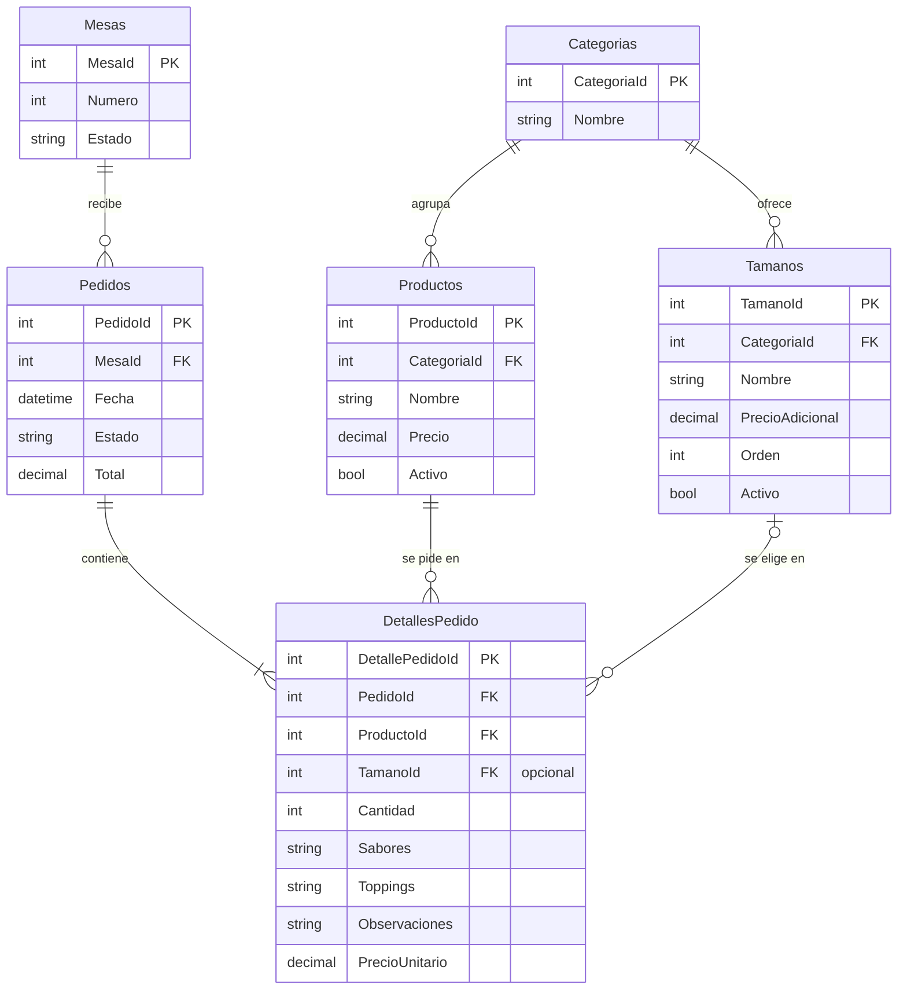

<p align="center">
  
</p>

# HeladeriaAPI

API REST en .NET 10 para gestionar pedidos de una heladería. Usa Dapper (Dapper.Contrib) con SQL Server y Swagger para probar los endpoints. Incluye un frontend en Angular (HeladApp) para clientes y personal.

## Equipo

Proyecto final del curso **Construcción de Software**, orientado por el profesor **Omar Andrés Cardona Zapata**. Desarrollado por:

- **Pedro Vidal**
- **Alexander Vélez**
- **Juan Silva**
- **Alejandro Ortega**
- **Juan Gallo**

El logo es una [ilustración de Cansu Sarp en Unsplash](https://unsplash.com/photos/rj4qZOnLpnw) (licencia de Unsplash, uso libre).

El repositorio original del equipo es [avelezfi/HeladeriaAPI](https://github.com/avelezfi/HeladeriaAPI). Esta copia continúa el proyecto con mejoras posteriores a la entrega (tamaños, administración del catálogo, login del personal y más pruebas); el historial de commits conserva el trabajo de cada integrante.

## Estructura

- `HeladeriaAPI`: proyecto Web API (Controllers, Swagger/XML, `Program.cs`).
- `HeladeriaAPI.Models`: clases de las tablas.
- `HeladeriaAPI.Query`: consultas de lectura (SELECT).
- `HeladeriaAPI.Repository`: operaciones de escritura (pedidos y catálogo).
- `BaseDeDatos/script.sql`: script para crear (o actualizar) la base de datos.
- `Frontend`: aplicación Angular (ver la sección "Frontend").
- `docs/openapi.yaml`: especificación OpenAPI de la API, exportada de Swagger.

## Requisitos

- .NET SDK 10
- SQL Server (local, Express, LocalDB o en Docker)
- Node.js 20 o superior (solo para el frontend)

## 1. Crear la base de datos

Ejecuta `BaseDeDatos/script.sql` en SQL Server Management Studio (o `sqlcmd`). Crea la base `HeladeriaAPI_DB`, sus tablas y datos de ejemplo (4 categorías, 8 productos, 5 tamaños y 5 mesas). Se puede ejecutar más de una vez sin duplicar datos, y **también actualiza una base creada con una versión anterior** (agrega la tabla de tamaños sin borrar los pedidos existentes).

Con `sqlcmd`, por ejemplo usando LocalDB (viene con Visual Studio):

```
sqlcmd -S "(localdb)\MSSQLLocalDB" -E -i BaseDeDatos\script.sql
```

### Modelo de datos



## 2. Configurar la cadena de conexión

Por defecto (`appsettings.json`) la API se conecta a `localhost` con autenticación de Windows. Si tu servidor es otro o usa usuario y contraseña, no subas la contraseña al repositorio: guárdala en tu equipo con user-secrets, reemplazando `TU_USUARIO`, `TU_CLAVE` y el servidor si hace falta:

```
dotnet user-secrets init --project HeladeriaAPI\HeladeriaAPI.csproj
dotnet user-secrets set "ConnectionStrings:DefaultConnection" "Server=localhost,1433;Database=HeladeriaAPI_DB;User Id=TU_USUARIO;Password=TU_CLAVE;TrustServerCertificate=True;" --project HeladeriaAPI\HeladeriaAPI.csproj
```

El puerto `1433` es el predeterminado de SQL Server. Cámbialo si tu instancia usa otro. Para LocalDB usa `Server=(localdb)\MSSQLLocalDB;Database=HeladeriaAPI_DB;Trusted_Connection=True;TrustServerCertificate=True;`.

## 3. Ejecutar

```
dotnet run --project HeladeriaAPI\HeladeriaAPI.csproj --launch-profile http
```

Abre `http://localhost:5152/swagger`. Para probar los endpoints del personal desde Swagger, ejecuta primero `POST /api/Auth/login`: la cookie de sesión queda guardada en el navegador. El archivo `HeladeriaAPI/HeladeriaAPI.http` trae ejemplos listos para probar desde Visual Studio o VS Code, y la especificación completa está en [`docs/openapi.yaml`](docs/openapi.yaml).

## Acceso del personal

Los **clientes no inician sesión**: eligen su mesa, piden y siguen su pedido sin registrarse, porque la mayoría no vuelve con frecuencia. Solo los **trabajadores** entran con usuario y contraseña en `/personal`.

| Rol | Puede |
|---|---|
| **Empleado** | Cocina (avanzar pedidos), historial de pedidos, resumen y mesas |
| **Administrador** | Todo lo anterior, más editar productos, categorías y tamaños, y gestionar los usuarios |

**Usuarios iniciales** (los crea el script):

| Usuario | Nombre | Rol | Contraseña inicial |
|---|---|---|---|
| `admin` | Administrador | Administrador | `HeladApp2026` |
| `excainer` | Juan Gallo | Administrador | `12345678` |
| `alejandro` | Alejandro Ortega | Administrador | `12345678` |
| `alexander` | Alexander Vélez | Administrador | `12345678` |
| `pedro` | Pedro Vidal | Administrador | `12345678` |
| `juan` | Juan Silva | Empleado | `12345678` |

**Estas contraseñas son públicas: cámbienlas en "Mi cuenta" la primera vez que entren** y creen un usuario para cada trabajador en "Usuarios".

Seguridad:

- La sesión viaja en una cookie `HttpOnly` y `SameSite=Strict`: JavaScript no puede leerla y el navegador no la envía desde otros sitios.
- Las contraseñas se guardan cifradas con PBKDF2 (el mismo formato de ASP.NET Identity); nunca se guardan ni se devuelven en texto.
- Máximo 10 intentos de inicio de sesión por minuto desde la misma dirección.
- En cada petición se revisa que el usuario siga activo: desactivar a alguien lo saca de inmediato.
- La protección está en la API, no solo en las pantallas: sin sesión los endpoints del personal responden `401`, y sin permiso `403`.

## Endpoints

🔓 = abierto (clientes) · 🔑 = requiere sesión del personal · 🛡️ = solo administradores

| | Método | Ruta | Descripción |
|---|---|---|---|
| 🔓 | POST | `/api/Auth/login`, `/api/Auth/logout` | Iniciar y cerrar sesión |
| 🔑 | GET · PUT | `/api/Auth/yo`, `/api/Auth/clave` | Usuario actual y cambio de contraseña propia |
| 🛡️ | GET · POST · PUT | `/api/Usuarios`, `/api/Usuarios/{id}` | Usuarios del personal |
| 🔓 | GET | `/api/Categorias`, `/api/Categorias/{id}` | Consulta de categorías |
| 🛡️ | POST · PUT | `/api/Categorias`, `/api/Categorias/{id}` | Crear y renombrar categorías |
| 🔓 | GET | `/api/Productos?categoriaId=`, `/api/Productos/categoria/{categoriaId}` | Lista de productos (filtro opcional por categoría) |
| 🔓 | GET | `/api/Productos/{id}` | Detalle de un producto **con sus tamaños** |
| 🛡️ | POST · PUT | `/api/Productos`, `/api/Productos/{id}` | Crear y editar productos (precio, categoría, disponibilidad) |
| 🔓 | GET | `/api/Tamanos?categoriaId=`, `/api/Tamanos/{id}` | Consulta de tamaños |
| 🛡️ | POST · PUT | `/api/Tamanos`, `/api/Tamanos/{id}` | Crear y editar tamaños |
| 🔓 | GET | `/api/Mesas`, `/api/Mesas/{id}` | Consulta de mesas |
| 🔓 | GET | `/api/Mesas/numero/{numero}` | Mesa por su número visible (el del código QR) |
| 🔑 | POST | `/api/Mesas/{id}/liberar` | Liberar una mesa cuando el cliente se va |
| 🔓 | GET | `/api/Pedidos/{id}`, `/api/Pedidos/{id}/detalles` | El cliente consulta su pedido |
| 🔑 | GET | `/api/Pedidos`, `/api/Pedidos/estado/{estado}`, `/api/Pedidos/mesa/{mesaId}` | Listas de pedidos para el personal |
| 🔓 | POST | `/api/Pedidos` | Crea un pedido con sus detalles (cliente, mesa obligatoria) |
| 🔑 | POST | `/api/Pedidos/personal` | El personal registra un pedido (mesa opcional = para llevar); queda quién lo registró |
| 🔑 | PUT | `/api/Pedidos/{id}/estado` | Avanza el estado del pedido |
| 🔑 | POST | `/api/Pedidos/{id}/cancelar` | Cancela un pedido pendiente |

### Reglas de negocio

- **Precio:** el cliente no envía precios. La API calcula cada ítem como *precio del producto + adicional del tamaño* con los valores de la base de datos, así nadie puede alterar lo que paga.
- **Tamaños:** se definen por categoría (por ejemplo, Helados: Pequeño, Mediano, Grande). Si la categoría de un producto tiene tamaños activos, hay que elegir uno; si no tiene, el producto se pide con su precio base.
- **Catálogo:** no se repiten nombres (categorías en general; productos y tamaños dentro de su categoría). Productos y tamaños no se borran: se desactivan, para conservar el histórico de pedidos.
- **Productos:** si un producto no existe la API responde `404`; si está inactivo, `400`.
- **Mesas:** una mesa queda *Ocupada* desde su primer pedido y sigue así hasta que el personal presiona **Liberar mesa** (`POST /api/Mesas/{id}/liberar`, empleados y administradores). No se puede liberar con pedidos sin entregar (`409`). La respuesta incluye `pedidosActivos` y `puedeLiberarse`.
- **Transacción:** el pedido y todos sus detalles se guardan juntos; si algo falla no queda nada a medias.
- **Estados:** `Pendiente` → `En Preparacion` → `Listo` → `Entregado`. Solo se puede avanzar al siguiente; retroceder o saltar un paso responde `409`.
- **Pedidos del personal:** empleados y administradores pueden registrar pedidos de clientes que piden en el mostrador o al mesero, para una mesa o **para llevar**. Se aplican las mismas reglas (precios del catálogo, tamaños, transacción) y queda guardado quién lo registró (`registradoPor`); los pedidos del cliente desde la mesa quedan sin ese dato.
- **Cancelar:** el personal puede cancelar un pedido solo mientras está `Pendiente` (`POST /api/Pedidos/{id}/cancelar`). Un pedido cancelado no cuenta en las ventas, no ocupa la mesa y no se puede reactivar. Si dos personas cancelan y empiezan a preparar a la vez, solo una acción se aplica.
- **Textos:** `sabores` y `toppings` admiten hasta 200 caracteres y `observaciones` hasta 300.

Ejemplo de cuerpo para `POST /api/Pedidos` (un helado grande y un brownie, que no maneja tamaños):

```json
{
  "mesaId": 1,
  "detalles": [
    { "productoId": 1, "tamanoId": 3, "cantidad": 2, "sabores": "Chocolate", "toppings": "Maní", "observaciones": "Sin crema" },
    { "productoId": 6, "cantidad": 1 }
  ]
}
```

## Frontend

Aplicación Angular en la carpeta `Frontend`. Tiene dos zonas:

- **Cliente** (`http://localhost:4200/`): elige su mesa (o entra por `/mesa/{numero}`, pensado para un código QR), elige tamaño, sabores y toppings, arma el pedido y sigue su estado en tiempo real. Cuando el pedido queda listo, el celular suena, vibra (Android) y muestra un aviso.
- **Personal** (`http://localhost:4200/personal`, con login): **nuevo pedido** (para mostrador o mesero), cocina (avanza o cancela pedidos, y suena cuando llega uno nuevo; se puede silenciar), historial de pedidos, resumen y, para administradores, **administración** de productos, categorías, tamaños y usuarios.

Con la API corriendo (paso 3):

```
cd Frontend
npm install
npm start
```

`npm start` redirige las llamadas a `/api` hacia `http://localhost:5152` (archivo `proxy.conf.json`), así que no hace falta configurar CORS.

Para trabajar en el frontend sin base de datos hay una API falsa con los mismos datos y reglas (mismos usuarios iniciales, más un empleado de ejemplo: `cocina` / `cocina2026`):

```
npm run mock        (en una terminal, puerto 5153)
npm run start:mock  (en otra terminal)
```

Pruebas unitarias: `npm test`.
